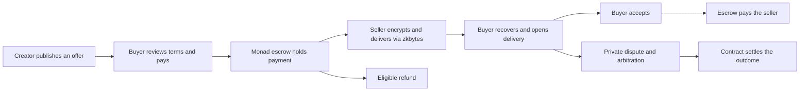

<p align="center">
  
</p>

<p align="center"><strong>Sell digital products and event access. Get paid through escrow. Deliver privately.</strong></p>

<p align="center">
  <a href="https://payunlock.zkbytes.com"><strong>Open the live demo</strong></a> ·
  <a href="https://payunlock.zkbytes.com/discover">Explore offers</a> ·
  <a href="https://zkbytes.com">Try zkbytes</a> ·
  <a href="#run-locally">Run locally</a>
</p>

<p align="center">
  
  
  
</p>

PayUnlock is a hackathon marketplace built around **on-chain escrow and encrypted delivery**. Creators publish offers, buyers pay with test MON or supported tokens, and both parties can recover their private deliveries through their wallets. The preview brings offer management, purchases, fulfillment, refunds, and dispute resolution into one app.


## Try the deployed apps

| Destination | What you can do |
| --- | --- |
| [PayUnlock marketplace](https://payunlock.zkbytes.com) | Browse featured offers and sign in with a wallet. |
| [Discover offers](https://payunlock.zkbytes.com/discover) | Explore the public catalog. |
| [Create an offer](https://payunlock.zkbytes.com/create) | Sign in to publish a digital product or event offer. |
| [Your purchases](https://payunlock.zkbytes.com/purchases) | Sign in to follow orders and open deliveries. |
| [zkbytes Message Lab](https://zkbytes.com) | Explore the encrypted storage service behind private delivery. |
| [API readiness](https://api.payunlock.zkbytes.com/ready) | Check the deployed API and database readiness. |

**This is a Monad Testnet preview.** Use test wallets and test assets. Complete V5 end-to-end acceptance and explorer source verification remain pending; see the [V5 cutover record](docs/V5_TESTNET_CUTOVER.md) for the validation scope.

## Built for buyers and creators

| For buyers | For creators |
| --- | --- |
| Discover digital products and event access. | Create, publish, update, or pause offers. |
| Pay with test MON or approved tokens, including test USDC. | Define the terms for future purchases. |
| Open encrypted deliveries and recover access. | Fulfill orders with encrypted text. |
| Accept delivery, claim eligible refunds, or start a private dispute. | Track orders, respond to disputes, and receive escrow payouts. |

Wallet options include **MetaMask, WalletConnect, and a built-in wallet**. Built-in accounts support passkeys on compatible devices, with password and recovery imports also available. Eligible USDC actions can use a funded relayer, allowing a buyer with zero MON to complete a sponsored purchase.

<details>
<summary><strong>See the deployed catalog</strong></summary>


Screenshots captured from the deployed app on October 9, 2026. Offers and availability can change.

</details>

## Private delivery, powered by zkbytes

<a href="https://zkbytes.com"></a>

[**zkbytes**](https://zkbytes.com) provides the encrypted content storage used by PayUnlock. The frontend integrates [`@zkbytes/sdk`](payunlock-frontend/package.json) to encrypt content before upload and recover it for the intended participants. Payments and escrow state live on Monad; encrypted delivery content lives in zkbytes.

- **Encrypt before upload:** fulfillment content is encrypted in the browser.
- **Recover access:** buyer and seller wallet flows restore access to their deliveries.
- **Separate content from settlement:** the contract tracks order state while zkbytes stores the encrypted payload.

Storage retention follows the configured service limits and offer terms. Wallet recovery depends on the account type; see the [passkey and recovery guide](docs/PASSKEY_RECOVERY.md).

## How an order works



Refunds, payouts, and disputes follow the order's contract rules and deadlines.

## Architecture


| Component | Responsibility | Source |
| --- | --- | --- |
| Web app | React interface, wallets, checkout, and browser encryption | [`payunlock-frontend`](payunlock-frontend) |
| API | Authentication, catalog, order coordination, and relay jobs | [`payunlock-backend`](payunlock-backend) |
| Contracts | V5 escrow, authorizations, refunds, payouts, and arbitration | [`payunlock-contract`](payunlock-contract) |
| Indexer | Synchronize contract events through Envio and Hasura | [`payunlock-indexer`](payunlock-indexer) |
| Shared API contracts | Types and schemas shared by the frontend and API | [`packages/api-contracts`](packages/api-contracts) |
| zkbytes | Encrypted content storage and recovery through its SDK | [Message Lab](https://zkbytes.com) |

The separate relayer worker submits supported signed authorizations. The V5 router also accepts valid authorizations from independent relayers. PostgreSQL stores application data; indexer data uses a separate database.

## Run locally

Requires **Node.js 24.11.0**, **pnpm 11.27.0**, and **Docker with Linux containers** running.

```sh
pnpm install --frozen-lockfile
pnpm env:init
pnpm db:start
pnpm db:migrate
pnpm dev
```

Open [http://127.0.0.1:4320](http://127.0.0.1:4320) to browse the local app. Setup preserves existing `.env` files; configure service settings using [`.env.example`](.env.example).

For passkeys, use [http://localhost:4320](http://localhost:4320). Passkeys are bound to the hostname where they were created. If needed, start the frontend with:

```sh
pnpm --filter @payunlock/frontend dev --host localhost
```

Start optional services separately:

```sh
# Sponsored V5 actions: requires a configured, funded testnet relayer.
pnpm dev:worker

# Local V5 event indexer.
pnpm indexer:build
pnpm indexer:start
```

Keep `VITE_WALLETS_ENABLED=true` to enable the wallet screen. WalletConnect also needs `VITE_REOWN_PROJECT_ID`. Restart after configuration changes. Credentials belong in the ignored `.env`; `VITE_` values are public browser configuration.

## Development checks

```sh
pnpm typecheck
pnpm lint
pnpm test
pnpm build

# Focused database and Solidity checks.
pnpm test:db
pnpm contract:test
```

Local checks and live testnet acceptance have separate scopes. Public deployment addresses and transaction evidence are recorded in the [V5 deployment record](payunlock-contract/deployments/monad-testnet-payunlock-v5.json).

## Project documentation

- [Preview guide](docs/PREVIEW_GUIDE.md) — wallet recovery, demo evidence, and platform administration.
- [Passkey recovery](docs/PASSKEY_RECOVERY.md) — account recovery and acceptance checks.
- [V5 testnet cutover](docs/V5_TESTNET_CUTOVER.md) — deployed contracts and outstanding acceptance work.
- [Railway deployment](docs/RAILWAY_DEPLOYMENT.md) — service layout, configuration, and release checks.
- [Contract guide](payunlock-contract/README.md) — local builds, deployment records, and ABI ownership.
- [USDC relayer design](docs/USDC_RELAYER_IMPLEMENTATION_PLAN.md) — sponsored payment architecture.

---

<p align="center">
  <br />
  <strong>PayUnlock</strong> · Private delivery with <a href="https://zkbytes.com">zkbytes</a> · Escrow on Monad
</p>
