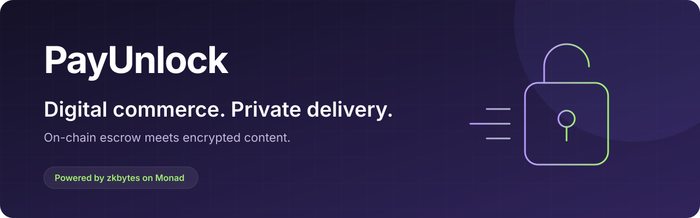
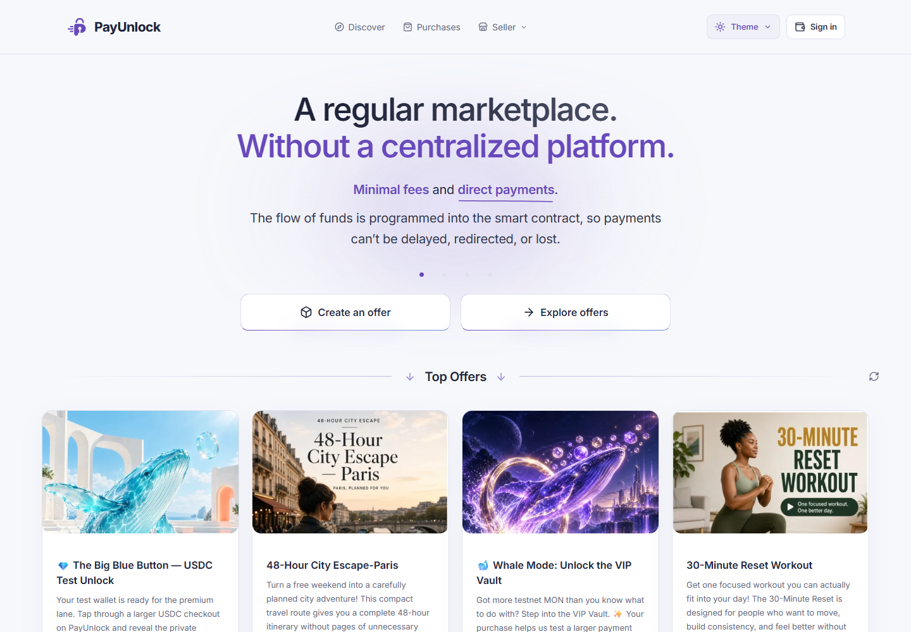
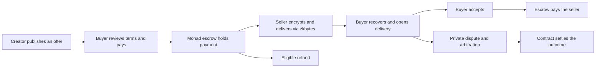
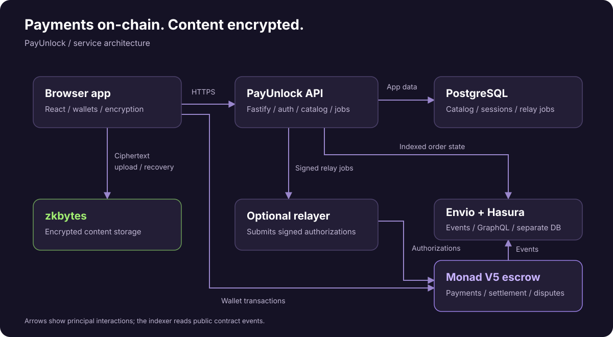
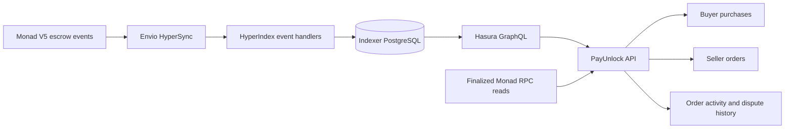

<p align="center">
  
</p>

<p align="center"><strong>Sell digital products and event access. Get paid through escrow. Deliver privately.</strong></p>

<p align="center">
  <a href="https://payunlock.zkbytes.com"><strong>Open the live demo</strong></a> ·
  <a href="https://payunlock.zkbytes.com/discover">Explore offers</a> ·
  <a href="https://zkbytes.com">Try zkbytes</a> ·
  <a href="#on-chain-data-powered-by-envio">Envio integration</a> ·
  <a href="#run-locally">Run locally</a>
</p>

<p align="center">
  
  
  
  
</p>

PayUnlock is a hackathon marketplace built around **on-chain escrow and encrypted delivery**. Creators publish offers, buyers pay with test MON or supported tokens, and both parties can recover their private deliveries through their wallets. The preview brings offer management, purchases, fulfillment, refunds, and dispute resolution into one app.



## Try the deployed apps

| Destination | What you can do |
| --- | --- |
| [PayUnlock marketplace](https://payunlock.zkbytes.com) | Browse featured offers and sign in with a wallet. |
| [Discover offers](https://payunlock.zkbytes.com/discover) | Explore the public catalog. |
| [Create an offer](https://payunlock.zkbytes.com/create) | Sign in to publish a digital product or event offer. |
| [Your purchases](https://payunlock.zkbytes.com/purchases) | Sign in to follow orders and open deliveries. |
| [zkbytes Message Lab](https://zkbytes.com) | Explore the encrypted storage service behind private delivery. |
| [API readiness](https://api.payunlock.zkbytes.com/ready) | Check the deployed API and database readiness. |

**This is a Monad Testnet preview.** Use test wallets and test assets. Complete V5 end-to-end acceptance and explorer source verification remain pending; see the [V5 cutover record](docs/V5_TESTNET_CUTOVER.md) for the validation scope.

## Built for buyers and creators

| For buyers | For creators |
| --- | --- |
| Discover digital products and event access. | Create, publish, update, or pause offers. |
| Pay with test MON or approved tokens, including test USDC. | Define the terms for future purchases. |
| Open encrypted deliveries and recover access. | Fulfill orders with encrypted text. |
| Accept delivery, claim eligible refunds, or start a private dispute. | Track orders, respond to disputes, and receive escrow payouts. |

Wallet options include **MetaMask, WalletConnect, and a built-in wallet**. Built-in accounts support passkeys on compatible devices, with password and recovery imports also available. Eligible USDC actions can use a funded relayer, allowing a buyer with zero MON to complete a sponsored purchase.

<details>
<summary><strong>See the deployed catalog</strong></summary>


Screenshots captured from the deployed app on October 9, 2026. Offers and availability can change.

</details>

## Private delivery, powered by zkbytes

<a href="https://zkbytes.com"></a>

[**zkbytes**](https://zkbytes.com) provides the encrypted content storage used by PayUnlock. The frontend integrates [`@zkbytes/sdk`](payunlock-frontend/package.json) to encrypt content before upload and recover it for the intended participants. Payments and escrow state live on Monad; encrypted delivery content lives in zkbytes.

- **Encrypt before upload:** fulfillment content is encrypted in the browser.
- **Recover access:** buyer and seller wallet flows restore access to their deliveries.
- **Separate content from settlement:** the contract tracks order state while zkbytes stores the encrypted payload.

Storage retention follows the configured service limits and offer terms. Wallet recovery depends on the account type; see the [passkey and recovery guide](docs/PASSKEY_RECOVERY.md).

## How an order works



Refunds, payouts, and disputes follow the order's contract rules and deadlines.

## Architecture



| Component | Responsibility | Source |
| --- | --- | --- |
| Web app | React interface, wallets, checkout, and browser encryption | [`payunlock-frontend`](payunlock-frontend) |
| API | Authentication, catalog, order coordination, and relay jobs | [`payunlock-backend`](payunlock-backend) |
| Contracts | V5 escrow, authorizations, refunds, payouts, and arbitration | [`payunlock-contract`](payunlock-contract) |
| Indexer | Synchronize contract events through Envio and Hasura | [`payunlock-indexer`](payunlock-indexer) |
| Shared API contracts | Types and schemas shared by the frontend and API | [`packages/api-contracts`](packages/api-contracts) |
| zkbytes | Encrypted content storage and recovery through its SDK | [Message Lab](https://zkbytes.com) |

The separate relayer worker submits supported signed authorizations. The V5 router also accepts valid authorizations from independent relayers. PostgreSQL stores application data; indexer data uses a separate database.

## On-chain data, powered by Envio

**Envio powers PayUnlock's buyer purchase discovery, seller order lists, and escrow activity history.** The application uses **HyperIndex 3.12.1** to turn Monad Testnet contract events into queryable entities, with **HyperSync** as the indexing data source. The indexer is self-hosted on Railway, alongside Hasura and a dedicated PostgreSQL database. See the [deployment guide](docs/RAILWAY_DEPLOYMENT.md) for the service layout.



### Features driven by indexed data

| App feature | How Envio contributes | Implementation |
| --- | --- | --- |
| Buyer purchases and seller orders | Query `ChainOrder` by participant and paginate order IDs; the API verifies the selected orders against finalized contract reads. | [Purchases](payunlock-frontend/src/commerce/Purchases.tsx), [Sales](payunlock-frontend/src/commerce/Sales.tsx) |
| Order activity history | Read ordered `ChainEvent` entries, including event names, block hashes, and transaction hashes, for the order's History view. | [Order views](payunlock-frontend/src/commerce/Orders.tsx) |
| Offer terms in the catalog | Combine `ChainProduct` with indexed configuration to present product status, price, payment-asset eligibility, and timing terms. | [Indexer query service](payunlock-backend/src/services/indexer-service.ts) |
| Arbitration and evidence | Discover arbitrators and assigned orders; query evidence and evidence-request entities with their assignment revisions. | [Commerce API routes](payunlock-backend/src/routes/commerce.ts) |
| Purchase transaction lookup | Retrieve the indexed `Purchased` transaction hash to help associate an existing order with its purchase. | [Indexer query service](payunlock-backend/src/services/indexer-service.ts) |

Without the indexer, the application cannot retrieve these participant order lists or indexed activity histories through their normal API paths. Offer metadata can remain readable during an indexing outage, and the UI reports when order history is syncing or unavailable.

### Escrow lifecycle and entity design

The [indexer configuration](payunlock-indexer/config.yaml) subscribes to **26 event types** from PayUnlock's escrow contract. The current demo runs on Monad Testnet; deployment addresses and indexing parameters are defined in the configuration. It covers product configuration, purchases, delivery reservation, published records, state transitions, settlement, arbitrator configuration and replacement, evidence, fees, and platform configuration.

The [GraphQL schema](payunlock-indexer/schema.graphql) defines **eight entities**:

| Entity | Indexed information |
| --- | --- |
| `ChainProduct` | Seller, product key, current configured status, and serialized product terms and order count |
| `ChainOrder` | Buyer, seller, payment terms, evolving escrow state, deadlines, conversation turn, and arbitration assignment |
| `ChainRecord` | Ordered delivery/conversation references, authors, and content commitments |
| `ChainEvidence` | Evidence references, submitters, commitments, and arbitration revisions |
| `ChainEvidenceRequest` | Requested evidence, participants, assignment context, and advisory dates |
| `ChainArbitrator` | Registered arbitrator configuration, public key, key version, and fee |
| `ChainEvent` | Chronological event history with block and transaction provenance |
| `ChainConfiguration` | Latest indexed configuration for payment assets, storage services, fees, and timing defaults |

The [event handlers](payunlock-indexer/src/handlers/escrow.ts) maintain derived state across multiple events. A purchase creates a `ChainOrder` and increments the indexed product's order count. Later events update delivery deadlines, review and response windows, conversation turns, settlement state, and arbitration revisions. Evidence entries remain separately addressable instead of being overwritten when an arbitrator changes.

Entity IDs include the chain ID and escrow address to separate deployments. Event IDs include block number and log index, and handlers guard against processing the same indexed event twice. Monetary values use `BigInt` and string serialization to preserve exact amounts.

### Finality, privacy, and recovery

Indexed results are explicitly marked **provisional**. Envio provides discovery and historical activity; the API uses finalized RPC reads to verify current financial state, participants, and action eligibility. The configuration enables `rollback_on_reorg` with a maximum reorg depth of 200 blocks. Handlers write only Envio-managed entities, keeping their writes within Envio's rollback mechanism and avoiding payment or fulfillment side effects during replay.

The indexer stores public event data, content commitments, and encrypted-content references. Delivery and conversation plaintext stays in the encrypted zkbytes flow described above; indexing does not decrypt it.

### Inspect the deployed data flow

The [live catalog API](https://api.payunlock.zkbytes.com/v1/products/featured) returns indexed sale terms and an `indexing` object containing `status`, `indexedBlock`, `sourceBlock`, and `lastProcessedAt`. Participant order lists also report `lagBlocks` relative to the finalized RPC block.

To inspect a public order list, replace `YOUR_WALLET_ADDRESS` with a lowercase wallet address that has testnet orders:

```sh
curl "https://api.payunlock.zkbytes.com/v1/public/orders?address=YOUR_WALLET_ADDRESS&role=buyer"
```

For an end-to-end demonstration:

1. Make a testnet purchase and note its order ID, transaction hash, and block number.
2. Refresh **Your purchases** and the seller's order list until that order appears.
3. Open the order's **History** view as an authenticated participant and compare its indexed purchase event and transaction hash with the explorer.
4. Show the Railway `payunlock-indexer` deployment and recent runtime indexing logs, together with the API's indexing progress.

The frontend and API are public; Hasura and the indexer remain private Railway services. API `/ready` checks application database readiness, while the `indexing` fields report the separate indexer's availability and progress.

### Indexer setup and validation

Use the indexer commands in [Run locally](#run-locally). Configure `ENVIO_API_TOKEN` for HyperSync access; `pnpm indexer:setup` prepares missing local database and Hasura settings while preserving existing values. The API connects using `ENVIO_GRAPHQL_URL` and `ENVIO_HASURA_ADMIN_SECRET`, which remain server-side configuration.

```sh
# Simulated escrow lifecycle tests using Envio's test indexer.
pnpm indexer:test

# Opt-in real-chain backfill test; configure a finalized end block first.
# Set PAYUNLOCK_LIVE_INDEXER_END_BLOCK in your local environment.
pnpm indexer:test:live
```

The [lifecycle tests](payunlock-indexer/test/lifecycle.test.ts) cover exact amounts, repeat purchases, conversation turns, arbitrator replacement, and retained evidence. The [live backfill test](payunlock-indexer/test/live.test.ts) indexes the configured V5 deployment twice and checks that purchases, events, and records rebuild deterministically. These are available validation paths; test results and live acceptance should be recorded for the deployment being demonstrated.

## Run locally

Requires **Node.js 24.11.0**, **pnpm 11.27.0**, and **Docker with Linux containers** running.

```sh
pnpm install --frozen-lockfile
pnpm env:init
pnpm db:start
pnpm db:migrate
pnpm dev
```

Open [http://127.0.0.1:4320](http://127.0.0.1:4320) to browse the local app. Setup preserves existing `.env` files; configure service settings using [`.env.example`](.env.example).

For passkeys, use [http://localhost:4320](http://localhost:4320). Passkeys are bound to the hostname where they were created. If needed, start the frontend with:

```sh
pnpm --filter @payunlock/frontend dev --host localhost
```

Start the relayer and indexer separately. The relayer is optional; the indexer is needed for indexed order discovery and history:

```sh
# Sponsored V5 actions: requires a configured, funded testnet relayer.
pnpm dev:worker

# Local V5 event indexer.
pnpm indexer:setup
pnpm indexer:build
pnpm indexer:start
```

Keep `VITE_WALLETS_ENABLED=true` to enable the wallet screen. WalletConnect also needs `VITE_REOWN_PROJECT_ID`. Restart after configuration changes. Credentials belong in the ignored `.env`; `VITE_` values are public browser configuration.

## Development checks

```sh
pnpm typecheck
pnpm lint
pnpm test
pnpm build

# Focused database and Solidity checks.
pnpm test:db
pnpm contract:test
```

Local checks and live testnet acceptance have separate scopes. Public deployment addresses and transaction evidence are recorded in the [V5 deployment record](payunlock-contract/deployments/monad-testnet-payunlock-v5.json).

## Project documentation

- [Preview guide](docs/PREVIEW_GUIDE.md) — wallet recovery, demo evidence, and platform administration.
- [Passkey recovery](docs/PASSKEY_RECOVERY.md) — account recovery and acceptance checks.
- [V5 testnet cutover](docs/V5_TESTNET_CUTOVER.md) — deployed contracts and outstanding acceptance work.
- [Railway deployment](docs/RAILWAY_DEPLOYMENT.md) — service layout, configuration, and release checks.
- [Contract guide](payunlock-contract/README.md) — local builds, deployment records, and ABI ownership.
- [Envio configuration](payunlock-indexer/config.yaml), [entity schema](payunlock-indexer/schema.graphql), and [event handlers](payunlock-indexer/src/handlers/escrow.ts) — the on-chain data pipeline.
- [USDC relayer design](docs/USDC_RELAYER_IMPLEMENTATION_PLAN.md) — sponsored payment architecture.

---

<p align="center">
  <br />
  <strong>PayUnlock</strong> · Private delivery with <a href="https://zkbytes.com">zkbytes</a> · Escrow on Monad
</p>
